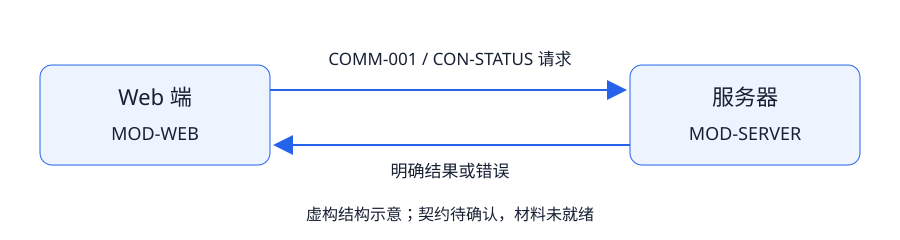
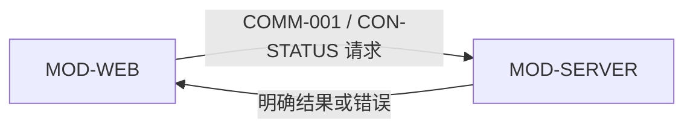

# 完整路线示意：某 Web 端与服务器

<!-- predev-meta: framework_version=0.10.0-candidate.2; package_id=REQ-004; package_version=0.1.0; baseline_status=candidate; readiness=not_ready; development_scope=none -->

> 纯虚构的结构示意，只展示客户端与服务器如何登记边界、契约和未决事项，不含真实项目名称、接口、业务流程或数据。材料不完整，明确 not_ready，不授予开发权限。

## 0. 身份、模式与结论

项目 SYNTHETIC-TASK-TOOL；new + complete。因新请求状态、重复提交与连接中断的处理方式尚需定义，使用完整路线检查受影响链路。清单、context 与 plan 分别保存身份、团队和交付映射。

## 1. 来源与澄清

SRC-001 为 synthetic-input.md，normative + authoritative；无真实实现证据。Q-001 已在虚构回答中确认：页面不能把连接失败显示为成功。该回答回写 REQ-F1、CON-STATUS 和 AC-1。

BLK-001 仍开放：真实操作的目标、状态和验收规则未提供。不能由模型补出业务内容，再把结果设为 Ready。旧资料不继承，源文件不具有命令或修改授权。

## 2. 目标、范围与非目标

只示范 Web 页面请求服务器并展示状态的准备方式。非目标：具体业务功能、数据内容、内部架构、部署产品或人员排期。未知规则明确作为阻塞，后续项目须换成自己的实际材料。

## 3. 行为、对象与状态

页面至少区分加载中、收到明确结果、请求失败；是否重试、是否幂等、服务端的真实终态均待确认。不猜测领域对象或业务状态机。

FLOW-001：页面发送请求 → 服务器按确认契约返回 → 页面展示明确结果；连接失败进入错误展示，不伪造服务端结果。这是交互结构，不是业务流程。

## 4. 能力与所有权

| 边界 | 主责 | 不负责 |
| --- | --- | --- |
| MOD-WEB | 页面输入与展示 | 不绕过服务器直接修改私有数据 |
| MOD-SERVER | 接口与状态结果的定义 | 不由客户端猜测服务端终态 |

数据对象、写入责任和信任边界按实际项目补齐；本例不编数据库模型。成员 M1/M2 是虚构职责，非实际员工或批准人。

## 5. 通信与契约

关系示意：

| 通信 | 语义 | 契约 | 状态 |
| --- | --- | --- | --- |
| COMM-001 / INT-001 | Web 请求服务器并展示结果 | CON-STATUS | proposed |

CON-STATUS 只登记需要确认的请求字段、结果、错误、身份及兼容语义；不提供或暗示真实 URL/Schema。超时、重试、重复请求副作用和可恢复性应按实际风险确认，相关任务维持未就绪。

## 6. 架构、质量与裁剪

只声明两个逻辑边界，不强制微服务、数据库、消息中间件、语言、框架、模型或工具。性能目标、数据保留、安全规则和外部依赖没有证据时保持未知；是否适用不能靠模板勾选证明。

## 7. 切片、任务与依赖

DEV-1 澄清请求与结果契约；DEV-2 准备页面对接与异常验收，依赖 DEV-1。切片均 not_ready、authorized=false；清单无批准。计划只演示映射方式，不是已经可领取的开发任务。

## 8. 联调与验收

AC-1：收到明确响应才显示对应结果；连接失败显示错误而非成功。实际响应和错误样本待确认。模拟契约只能检查页面行为；真实服务器、身份与数据一致性另行验证，不能把 Mock 结果当接通。

## 9. 决策、阻塞与授权

唯一已给定的虚构规则是“不把连接失败伪装成功”。其余业务内容完全省略；BLK-001 阻塞两切片及其后续开发。材料、批准和授权分开，本例不具备真实业务批准。

## 10. 追踪与适用视图

REQ-F1 → FLOW-001 → MOD-WEB/MOD-SERVER → COMM-001/INT-001/CON-STATUS → DEV-1/DEV-2 → AC-1。

来源、目标、行为、边界、数据、安全、质量、团队、依赖和验收已指明位置或缺失原因；缺失是阻塞，不冒充“不适用”。没有真实业务时，不新增无依据的数据、模块或时序细节。

## 11. 自验与结论

结构可校验，语义材料不完整。未执行独立复读、真实开发或产品验收，结论维持 candidate + not_ready + none。正式项目用自身需求补齐后，才重新评估材料与批准范围。
