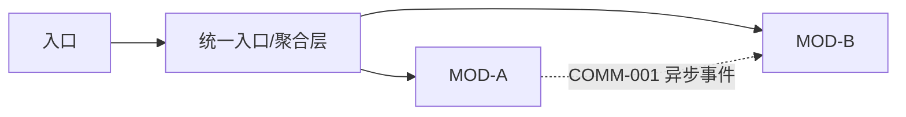

# 架构约束与契约

## 系统架构图

> 复杂项目使用 Mermaid 展示入口、模块、数据边界、异步设施、适配层和外部系统。图中候选与已确认内容必须显式区分。

## 模块通信模型

| 通信ID | 场景/关联流程 | 请求方 → 提供方 | 业务语义 | 同步/异步/人工 | 当前逻辑通道 | 事务与一致性 | 幂等/失败恢复 | 关联交互/契约 | 状态 |
| --- | --- | --- | --- | --- | --- | --- | --- | --- | --- |
| `COMM-001` | `FLOW-001` | `MOD-A → MOD-B` | 查询/命令/事实事件 | 同步/异步/人工 | 模块接口/Outbox/适配器等 | 提交点与强/最终一致 | 超时、重试、去重、补偿 | `INT-001` / `CON-001` | draft |

### 页面/API 读聚合

| 聚合入口 | 组装主责 | 数据提供者 | 同步查询或投影 | 快照/新鲜度 | 权限与失败降级 |
| --- | --- | --- | --- | --- | --- |

### 请求与消息公共信封

- 同步请求：请求标识、Trace、契约版本、服务端确认的租户/主体、命令幂等键、错误与可重试语义。
- 异步消息：消息标识、类型、Schema 版本、发生时间、生产者、租户、Trace、关联/因果标识、幂等键、载荷。
- 这里冻结跨边界业务语义；HTTP、RPC、队列产品、类名和私有字段仍可延迟到技术基线或开发阶段。

### 事务、一致性与恢复

| 业务动作 | 写入所有者/本地事务 | 跨边界后续 | 一致性目标 | 部分成功与恢复 | 可见状态 |
| --- | --- | --- | --- | --- | --- |

## 关键质量属性

| 属性ID | 场景与刺激 | 预期响应 | 度量 | 取舍 |
| --- | --- | --- | --- | --- |

## 架构边界

- 技术栈与版本基线：
- 工程/仓库边界：
- 运行/部署边界：
- 模块依赖规则：
- 外部系统和适配边界：

## 数据

| 数据对象 | 所有模块 | 创建 | 修改 | 读取者 | 保留/删除 | 迁移/兼容 |
| --- | --- | --- | --- | --- | --- | --- |

## 正式契约

| 契约ID | 类型 | 提供者 | 消费者 | Schema位置 | 错误/状态 | 版本策略 | 状态 |
| --- | --- | --- | --- | --- | --- | --- | --- |

## 通用语义

- 身份与权限：
- 时间和时区：
- 金额/计量/精度：
- 错误分类：
- 幂等：
- 超时与重试：
- 兼容和废弃：

## 决策

| 决策ID | 问题 | 选择 | 备选 | 理由和取舍 | 负责人 | 状态 |
| --- | --- | --- | --- | --- | --- | --- |

## 延迟到开发的自主决策

- 私有函数、内部类、局部变量、文件内部组织：由开发执行者决定。
- 具体Skill、Agent、工具、调试和实现策略：由开发执行者决定。
